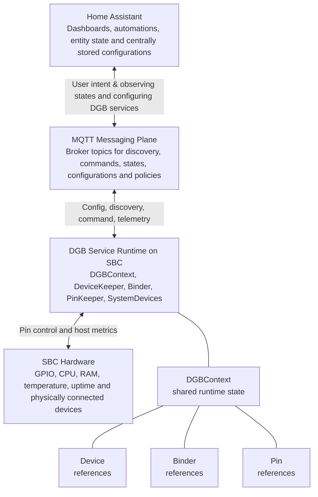

# HMD-DGB: Home Assistant MQTT-Discoverable Device GPIO Binder

[](https://www.apache.org/licenses/LICENSE-2.0)
[](https://github.com/jvanoosterhout/HMD-DGB)
[](https://github.com/jvanoosterhout/HMD-DGB/actions/workflows/CI-python-package.yml)
[](https://github.com/jvanoosterhout/HMD-DGB/releases)
[](https://github.com/jvanoosterhout/HMD-DGB/releases)

Control Raspberry Pi GPIO pins via MQTT with devices that Home Assistant discovers automatically. Connect your hardware to smart home automation through declarative device bindings using Durable Rules.

HMD-DGB has two key strengths:
- It allows you to configure complex entities that can rely on multiple sensors and actuators, such as a cover (control open/close/stop, sense is_open/is_closed) or a light (RGBW).
- It allows you to manage the node (the Raspberry Pi/SBC), service, and configurations from Home Assistant or another central location. This lets you use Home Assistant to store configurations as the single source of truth, without filling it with helpers or intermediate entities.

<!-- START doctoc generated TOC please keep comment here to allow auto update -->
<!-- DON'T EDIT THIS SECTION, INSTEAD RE-RUN doctoc TO UPDATE -->
## Table of Contents

- [Overview](#overview)
  - [Current implementation status](#current-implementation-status)
- [Requirements](#requirements)
  - [Hardware & OS](#hardware--os)
  - [Software](#software)
  - [Tested Platforms](#tested-platforms)
- [Installation](#installation)
  - [Option 1: venv](#option-1-venv)
  - [Option 2: Docker](#option-2-docker)
  - [MQTT topics and --topic](#mqtt-topics-and---topic)
  - [Operational caveats](#operational-caveats)
- [Example projects](#example-projects)
- [Reference documentation](#reference-documentation)
  - [Node & system health & control](#node--system-health--control)
  - [Basic configuration](#basic-configuration)
  - [Startup actions](#startup-actions)
  - [Devices with EntityInfo](#devices-with-entityinfo)
    - [Device](#device)
    - [Basic parameters (for all entities)](#basic-parameters-for-all-entities)
    - [Binary sensor](#binary-sensor)
    - [Cover](#cover)
    - [Number](#number)
    - [Select](#select)
    - [Sensor](#sensor)
    - [Switch](#switch)
    - [Text](#text)
    - [Valve](#valve)
  - [Pins with PinInfo](#pins-with-pininfo)
    - [PinIn](#pinin)
    - [PinOut](#pinout)
    - [PinCount](#pincount)
    - [PinNWayOut](#pinnwayout)
  - [Bindings with BindInfo](#bindings-with-bindinfo)
    - [Ruleset](#ruleset)
    - [Rule conditions](#rule-conditions)
    - [Rule run actions](#rule-run-actions)
      - [Log](#log)
      - [Timer](#timer)
      - [Action](#action)
  - [Startup policy](#startup-policy)
- [Architecture](#architecture)
- [Ideas for improvement](#ideas-for-improvement)
- [Known Issues & Limitations](#known-issues--limitations)
  - [Event argument references](#event-argument-references)
  - [Events during configuration loading](#events-during-configuration-loading)
  - [Count-Type Pin Device](#count-type-pin-device)
  - [Maintenance/updates of Durable Rules](#maintenanceupdates-of-durable-rules)
- [Licence](#licence)
- [Contributing](#contributing)
- [Project Status](#project-status)

<!-- END doctoc generated TOC please keep comment here to allow auto update -->


## Overview

**HMD-DGB** (Home Assistant MQTT-Discoverable Device GPIO Binder) provides a Python-based solution for managing GPIO pins on a Raspberry Pi and binding them to Home Assistant devices via MQTT discovery. It is an end-to-end solution that uses [ha-mqtt-discoverable](https://github.com/unixorn/ha-mqtt-discoverable) for MQTT discovery and [Durable Rules](https://github.com/jruizgit/rules) to bind these devices to [GPIO Zero](https://github.com/gpiozero/gpiozero) pins. It replaces manual programming with more intuitive JSON configuration. Over the years, the package has developed some similarities to ESPHome while retaining its own approach.


The vision and future plans for HMD-DGB are described in [DGB-systems](https://github.com/jvanoosterhout/DGB-systems). It provides the system-wide context, architecture, and design history for the HMD-DGB ecosystem. In short, the vision is to create a flexible solution for configuring and managing edge devices and nodes, such as Raspberry Pis, with almost no need to edit code on the nodes themselves. Node configurations are managed centrally from Home Assistant. Ideally, after installing the OS and HMD-DGB, everything can be managed from Home Assistant, including package updates and configuration of GPIO pins, devices, and bindings.

The system consists of four core concepts:

- **MQTT-discoverable devices**: Devices that automatically appear in Home Assistant via the MQTT discovery protocol.
- **Durable binding rules**: Rules that define relationships and actions between physical GPIO pins and Home Assistant devices.
- **GPIO Zero devices**: GPIO pins configured to perform meaningful actions in the real world.
- **On-the-fly configuration**: Send device, binding, and GPIO configurations over MQTT to your Raspberry Pi. You still need to install this package, configure Home Assistant, and set up the MQTT service.

### Current implementation status

The table below reflects the current implementation status in this repository.

| Area | Implemented |
|---|---|
| Home Assistant entities | `binary_sensor`, `cover`, `valve`, `sensor`, `switch`, `text`, `number`, `select` |
| GPIO pin types (`PinInfo.ptype`) | `in`, `out`, `count`, `nwayout` |
| Binder run actions | `log`, `timer` (`start` and `cancel`), `action` |

[top](#table-of-contents)

## Requirements

### Hardware & OS

- **Raspberry Pi**: Pi 4 or Pi Zero 2 W (or compatible board)
  - Some dependencies, including Durable Rules, psutil, and lgpio, may need to build native extensions locally.
  ```bash
  sudo apt install -y git gcc build-essential swig liblgpio-dev python3-dev python3-venv
  ```
- **Operating System**: Bookworm or newer recommended
  - Bullseye may work with GPIO Zero falling back to RPi.GPIO
  - Not tested on older versions

### Software

- **Python**: 3.10-3.14
- **MQTT Broker**: Mosquitto or compatible
- **Home Assistant**: 2023.1 or later

### Tested Platforms

- Raspberry Pi 4 with Bookworm (64-bit, desktop) and Python 3.11.2
- Raspberry Pi Zero 2 W with Bookworm (32-bit, lite) and Python 3.10
- Raspberry Pi Zero 2 W with Trixie (32-bit, lite) and Python 3.13

[top](#table-of-contents)

## Installation

### Option 1: venv

```bash
# Create a project directory and virtual environment
mkdir hmd-dgb-project && cd hmd-dgb-project
sudo apt -y install python3-venv
python3 -m venv venv
. venv/bin/activate
python -m pip install --upgrade pip
# Install from the repository
python -m pip install git+https://github.com/jvanoosterhout/HMD-DGB.git
```

Start the service, replacing the example values with your service name, broker address, and MQTT credentials:

```bash
python -m DGB.DGBservice --name "my-service-name" --broker "my-broker" \
  --username "my-username" --password "my-password"
```

Optional arguments include `--port 1883`, `--location "my-location"`, and `--rate 60`. Both `--port` and `--rate` require integers; `--rate` sets the system sensor update interval in seconds. Use `python -m DGB.DGBservice --help` to list the available arguments.

[top](#table-of-contents)

### Option 2: Docker

Docker support is on the roadmap for simplified deployment and consistency across systems.
There is currently no Dockerfile or Docker Compose setup in this repository.

### Operational caveats

- The service restart actions are designed for deployments managed by a supervisor (for example `systemd`) that automatically starts the process again after it exits.
- While configurations are being loaded, devices and pins may emit events before all bindings are registered. In that case, early events can be missed until binding setup is complete.

[top](#table-of-contents)

## Example projects

For inspiration on using HMD-DGB and designing custom IoT hardware, take a look at these personal projects:

- **[DGB-systems](https://github.com/jvanoosterhout/DGB-systems)**: System-wide context, architecture, and design history
- **[MK controller](https://github.com/jvanoosterhout/MKcontroller)**: Make conventional utility cupboard systems (Dutch: meterkast → MK) smart and connect them to Home Assistant. It connects a doorbell and a water meter. It can also silence the physical doorbell while retaining its sensor function for notifications.
- **[G controller](https://github.com/jvanoosterhout/Gcontroller)**: Make conventional garage systems (Dutch: garage → G) smart and connect them to Home Assistant. It connects and controls the garden irrigation system and electric garage door.

[top](#table-of-contents)

## Reference documentation

### Node & system health & control

When the HMD-DGB service starts, it creates a discoverable DGB node and DGB service for the given service name. Both devices have sensors, controls, and basic information.

DGB node (with the service name):
- CPU usage
- RAM usage
- CPU temperature
- Node uptime (from `time.monotonic()`)

DGB service (with the service name):
- Currently installed software version
- Service uptime, which may differ from node uptime if the service has restarted or crashed
- Soft restart (set all entities to unavailable, restart the service, and leave other MQTT messages untouched)
- Hard restart (clear the service configuration topic and restart the service)

In DGB, your own Home Assistant devices are automatically linked as children of the DGB service device. You can configure your devices in an [HMD](https://github.com/unixorn/ha-mqtt-discoverable) JSON configuration using the `device` key. DGB slightly modifies this configuration: it sets or overrides the `via_device` key with the unique ID of the DGB service device. As a result, the service device lists all devices created by the service, and each device links back to the service, making Home Assistant easier to navigate.

[top](#table-of-contents)

### Basic configuration

Once the HMD-DGB service is running on a Raspberry Pi/SBC and connected to an MQTT broker (with Home Assistant as a subscriber), publish a configuration message via MQTT to the configuration topic `config/{name}/devices/`. This message can configure devices (Home Assistant entities optionally grouped into devices), GPIO pins, and bindings between them.

A schematic example, not valid JSON, where `...` represents omitted configuration details:

```text
{
  "Devices": [
    {"EntityInfo": {...}}
  ],
  "Pins": [
    {"PinInfo": {...}}
  ],
  "Bindings": [
    {"BindInfo": {...}}
  ],
  "state_initialization": {...}
}
```
The following sections explain how to fill in this message.

Before any device, pin, or binding is created, DGB validates the structure of the payload, including required keys such as `EntityInfo.component`, `EntityInfo.unique_id`, `PinInfo.pin`, `PinInfo.unique_id`, `PinInfo.ptype`, and `BindInfo`, as well as any `state_initialization` entries. It also checks that every `unique_id` occurs only once across all devices and pins in the payload. A structurally invalid payload causes the configuration cycle to fail in the same way as a device, pin, or binding creation failure. The resulting behaviour is governed by `error_state_policy`, see [Startup policy](#startup-policy).

[top](#table-of-contents)

### Startup actions

Startup actions restore or set object states after devices and pins have been created, but before bindings become live. These actions can be set via the `state_initialization` key in the regular configuration payload on `config/{name}/devices/`. It has two optional lists:
- `preset_action` defines a configured default
- `persist_action` selects actions to publish and restore through the retained MQTT namespace `config/{name}/retained-actions/{unique_id}/{call}`.

When the DGB service starts, it checks for retained messages under `config/{name}/retained-actions/#`. Actions can only be restored when a retained message exists. A retained action only overrides a preset when its operation is listed in `persist_action` for that `unique_id`. If you remove an operation from `persist_action`, the service may still load the retained message, but it will not apply it to the device.

Configured preset values use the `set_state` call with one named state value per argument object. Each argument uses the schematic form `{ "name": "...", "value": ... }`. Multiple named states may be supplied in one call. Retained messages for other calls are stored and can be selected with `persist_action`, provided that the target object exposes that call.

Example startup actions for an HMD switch and a GPIO count pin:
```json
{
  "Devices": [],
  "Pins": [],
  "Bindings": [],
  "state_initialization": {
    "preset_action": [
      {
        "unique_id": "switch_one",
        "call": "set_state",
        "args": [{"name": "state", "value": "off"}]
      },
      {
        "unique_id": "water_meter_pin_5",
        "call": "set_state",
        "args": [{"name": "count_total", "value": 42}]
      }
    ],
    "persist_action": [
      {
        "unique_id": "switch_one",
        "call": ["set_state"]
      },
      {
        "unique_id": "water_meter_pin_5",
        "call": ["set_state"]
      }
    ]
  }
}
```

For example, publish the retained message below to `config/{name}/retained-actions/switch_one/set_state` to restore `switch_one` as 'on' instead of using the preset value 'off':

```json
{
  "args": [{"name": "state", "value": "on"}]
}
```

Note that the blink state of PinOut cannot be retained in an MQTT topic. Blinking is a temporary state that is only valid at the time of execution; after a system restart, the condition that triggered it may no longer be valid.

[top](#table-of-contents)

### Devices with EntityInfo

This section lists the configuration parameters and defaults for devices discoverable by Home Assistant. The [ha-mqtt-discoverable](https://github.com/unixorn/ha-mqtt-discoverable) package configures and manages these devices. HMD-DGB builds on this package with additional parameters, which are indicated alongside the ha-mqtt-discoverable parameters. This section also lists the `run.action.call` names and `run.action.args` that can be used in bindings via [Durable Rules](https://github.com/jruizgit/rules).

[top](#table-of-contents)

#### Device

A device groups entities in Home Assistant. This section describes devices; the following sections describe the entities that can belong to them. The [Home Assistant documentation](https://www.home-assistant.io/getting-started/concepts-terminology/) defines a device as follows:
> Devices are a logical grouping for one or more entities. A device may represent a physical device, which can have one or more sensors. The sensors appear as entities associated with the device. For example, a motion sensor is represented as a device. It may provide motion detection, temperature, and light levels as entities. Entities have states such as detected when motion is detected and clear when there is no motion.

HMD parameters:

| Parameter          | Description                                                                 | Type               | Requirement  |
|-------------------|-----------------------------------------------------------------------------|--------------------|----------|
| name              | Name of the device.                                                         | str                | required |
| model             | Model of the device.                                                        | str                | optional |
| manufacturer      | Manufacturer of the device.                                                 | str                | optional |
| sw_version        | Firmware version of the device.                                             | str                | optional |
| hw_version        | Hardware version of the device.                                             | str                | optional |
| identifiers       | A list of IDs that uniquely identify the device (e.g. a serial number).     | list[str] \| str   | optional |
| connections       | A list of connections to the outside world as tuples `[type, identifier]`.  | list[tuple]        | optional |
| configuration_url | Link to a webpage to manage device configuration (HTTP or HTTPS).           | str                | optional |
| suggested_area    | Suggested name for the area where the device is located.                    | str                | optional |
| via_device        | Identifier of a device that routes messages between this device and Home Assistant (e.g. hub or parent device). | str                | optional |

```json
{
  "name": "Example Device",
  "model": "Model X",
  "manufacturer": "Example Corp",
  "sw_version": "1.0.0",
  "hw_version": "revA",
  "identifiers": ["SN-123456"],
  "connections": [["mac", "00:11:22:33:44:55"]],
  "configuration_url": "http://192.168.1.10",
  "suggested_area": "Living Room",
  "via_device": "example_hub"
}
```

In DGB, devices can only be configured within an entity using the `device` key. Its value has the structure shown above. DGB slightly modifies this JSON: it sets or overrides the `via_device` key with the unique ID of the DGB service device.

[top](#table-of-contents)

#### Basic parameters (for all entities)

The following parameters are shared by all entities and can be added to the `EntityInfo` configuration of each entity described below.

| Parameter           | Description                                                                 | Type       | Requirement  |
|--------------------|-----------------------------------------------------------------------------|------------|----------|
| component          | One of the supported MQTT components, for instance `binary_sensor`.         | str        | required |
| name               | Name of the sensor inside Home Assistant.                                   | str        | required |
| device             | Information about the device this sensor belongs to.                        | DeviceInfo | optional |
| device_class       | Sets the class of the device, changing the device state and icon displayed on the frontend. | str        | optional |
| enabled_by_default | Flag that defines whether the entity should be enabled when first added.        | bool       | optional |
| entity_category    | Classification of a non-primary entity.                                     | str        | optional |
| expire_after       | Number of seconds after which the sensor’s state expires if it is not updated. After expiry, the sensor’s state becomes unavailable. By default, the sensor state never expires. | int        | optional |
| force_update       | Sends update events even if the value has not changed. Useful for meaningful value graphs in history. | bool       | optional |
| icon               | Icon for the sensor.                                                        | str        | optional |
| object_id          | Set this to generate the `entity_id` in Home Assistant instead of using `name`. | str        | optional |
| qos                | The maximum QoS level to be used when receiving messages.                   | int        | optional |
| unique_id          | Set this to enable editing the sensor from the Home Assistant UI and to integrate with a device. | str        | optional |
| display_name       | Display name for the Home Assistant UI. If not set, `name` is used.         | str        | optional |


```json
{
  "component": "sensor",
  "name": "Example Sensor",
  "device_class": "temperature",
  "enabled_by_default": true,
  "entity_category": "diagnostic",
  "expire_after": 60,
  "force_update": false,
  "icon": "mdi:thermometer",
  "object_id": "example_sensor",
  "qos": 0,
  "unique_id": "example_sensor_001",
  "display_name": "Example Sensor"
}
```

[top](#table-of-contents)

#### Binary sensor

HMD parameters:

| Parameter    | Description                                                                 | Type | Default  |
|-------------|-----------------------------------------------------------------------------|------|---------|
| component   | One of the supported MQTT components. For this sensor, defaults to `binary_sensor`. | str  | `binary_sensor` |
| off_delay   | For sensors that only send state updates (e.g. PIR sensors), sets a delay in seconds after which the sensor state is automatically updated back to `off`. | int  | None|
| payload_off | Payload to send for the OFF state.                                          | str  | `off` |
| payload_on  | Payload to send for the ON state.                                           | str  | `on` |

```json
{
  "component": "binary_sensor",
  "payload_on": "on",
  "payload_off": "off",
  "off_delay": 30
}
```

DGB binder calls (`run.action.call`) and their optional arguments (`run.action.args`). These can also be used for `preset_action` and are stored in the retained-actions topic:

| Call name    | Description                                                                 | Argument | Type | Description |
|-------------|------------------------------------------------------------------------------|----------|------|-------------|
| off | Set binary sensor to off. | | | |
| on | Set binary sensor to on. | | | |
| set_state | Set the binary sensor state. | `name`, `value` | `str`, `bool \| int \| str` | `name` must be `state`; `value` accepts `on`/`off`, `true`/`false`, or `1`/`0`. |

[top](#table-of-contents)

<!-- #### Button (not implemented yet)

This component is not implemented in the current runtime yet.

HMD parameters:

| Parameter      | Description                                                                 | Type | Default |
|---------------|-----------------------------------------------------------------------------|------|---------|
| component     | One of the supported MQTT components. For this entity, defaults to `button`. | str  | `button` |
| payload_press | Payload sent to trigger the button press.                                   | str  | `PRESS` |
| retain        | Defines whether the published MQTT message should have the retain flag set. | bool | `False` |

```json
{
  "component": "button",
  "payload_press": "PRESS",
  "retain": false
}
```

[top](#table-of-contents)

#### Camera (not implemented yet)

HMD parameters:

| Parameter        | Description                                                                 | Type | Default |
|------------------|-----------------------------------------------------------------------------|------|---------|
| component        | The MQTT component type for this entity.                                    | str  | `camera` |
| topic            | MQTT topic subscribed to receive image payloads.                            | str  | required |
| retain           | Defines whether the published MQTT message should have the retain flag set. | bool | optional |
| image_encoding   | Encoding of received image payloads. Set to `b64` to enable base64 decoding. If not set, the payload must be raw binary image data. | str | optional |

```json
{
  "component": "camera",
  "topic": "example/camera/image",
  "retain": false,
  "image_encoding": "b64"
}
```

DGB binder calls (`run.action.call`) and their optional arguments (`run.action.args`):

| Call name    | Description                                                                 | Argument | Type | Description |
|-------------|------------------------------------------------------------------------------|----------|------|-------------|
| set_payload   | Update the image payload of the camera.                                  | image_payload  | bytes or str |  image payload to be published to topic |

[top](#table-of-contents) -->

#### Cover

HMD parameters:

| Parameter         | Description                                                                 | Type | Default |
|------------------|-----------------------------------------------------------------------------|------|---------|
| component        | One of the supported MQTT components. For this entity, defaults to `cover`. | str  | `cover` |
| optimistic       | Flag that defines whether the cover works in optimistic mode. The default behaviour is `true` if no `state_topic` is defined, otherwise `false`. | bool | None |
| payload_close    | Command payload used to close the cover.                                    | str  | `CLOSE` |
| payload_open     | Command payload used to open the cover.                                     | str  | `OPEN` |
| payload_stop     | Command payload used to stop the cover.                                     | str  | `STOP` |
| position_closed  | Numeric value that represents the fully closed position.                   | int  | `0` |
| position_open    | Numeric value that represents the fully open position.                     | int  | `100` |
| state_open       | Payload that represents the open state.                                    | str  | `open` |
| state_opening    | Payload that represents the opening state.                                 | str  | `opening` |
| state_closed     | Payload that represents the closed state.                                  | str  | `closed` |
| state_closing    | Payload that represents the closing state.                                 | str  | `closing` |
| state_stopped    | Payload that represents the stopped state.                                 | str  | `stopped` |
| retain           | Defines whether the published MQTT message should have the retain flag set. | bool | `False` |

```json
{
  "component": "cover",
  "optimistic": false,
  "payload_open": "OPEN",
  "payload_close": "CLOSE",
  "payload_stop": "STOP",
  "position_open": 100,
  "position_closed": 0,
  "state_open": "open",
  "state_opening": "opening",
  "state_closed": "closed",
  "state_closing": "closing",
  "state_stopped": "stopped",
  "retain": false
}
```

DGB parameters:

| Parameter         | Description                                                                 | Type | Default |
|------------------|-----------------------------------------------------------------------------|------|---------|
| time_based_state        | Reserved for time-based cover position calculation. Currently accepted but ignored. | bool  | `False` |
| direct_state_transition  | If `True`, cover states change directly in response to payload commands; otherwise, states must be managed via the binder using `run.action.call`. | bool | `True` |

DGB binder calls (`run.action.call`) and their optional arguments (`run.action.args`). These can also be used for `preset_action` and are stored in the retained-actions topic:

| Call name    | Description                                                                 | Argument | Type | Description |
|-------------|------------------------------------------------------------------------------|----------|------|-------------|
| open        | Set cover state to open                                                      |          |      |             |
| closed      | Set cover state to closed                                                      |          |      |             |
| closing     | Set cover state to closing                                                      |          |      |             |
| opening     | Set cover state to opening                                                      |          |      |             |
| stopped     | Set cover state to stopped                                                      |          |      |             |
| set_state | Set the cover state from a command payload. | `name`, `value` | `str`, `str` | `name` must be `state`; `value` must equal `payload_open`, `payload_close`, or `payload_stop`. |

[top](#table-of-contents)

<!-- #### Device trigger (not implemented yet)

HMD parameters:

| Parameter        | Description                                                                 | Type | Default |
|------------------|-----------------------------------------------------------------------------|------|---------|
| component        | The MQTT component type for this entity.                                    | str  | `device_automation` |
| automation_type  | Type of automation. Must be `trigger`.                                      | str  | `trigger` |
| payload          | Optional payload to match against the payload received on the topic.       | str  | None |
| type             | The type of the trigger.                                                    | str  | required |
| subtype          | The subtype of the trigger.                                                 | str  | required |

```json
{
  "component": "device_automation",
  "automation_type": "trigger",
  "type": "button_short_press",
  "subtype": "button_1",
  "payload": "PRESS"
}
```

DGB binder calls (`run.action.call`) and their optional arguments (`run.action.args`). These can also be used for `preset_action` and are stored in the retained-actions topic:

| Call name    | Description                                                                 | Argument | Type | Description |
|-------------|------------------------------------------------------------------------------|----------|------|-------------|
| trigger   | Generate a device trigger event                                  | payload  | str |  Custom payload to send in the trigger topic |

[top](#table-of-contents)

#### Image (not implemented yet)

HMD parameters:

| Parameter        | Description                                                                 | Type | Default |
|------------------|-----------------------------------------------------------------------------|------|---------|
| component        | The MQTT component type for this entity.                                    | str  | `image` |
| url_topic        | MQTT topic used to receive an image URL. Cannot be used together with `image_topic`. | str  | None |
| image_topic      | MQTT topic used to receive raw image payloads. Cannot be used together with `url_topic`. | str  | None |
| image_encoding   | Encoding of image payloads. Set to `b64` to enable base64 decoding. If not set, payloads must be raw binary data. | str | None |
| content_type     | Content type to use when sending image payloads. Cannot be used together with `url_topic`. | str | None |

Example using `image_topic` (binary or base64 payload):

```json
{
  "component": "image",
  "image_topic": "example/image/raw",
  "image_encoding": "b64",
  "content_type": "image/jpeg"
}
```

Alternative example using `url_topic`:

```json
{
  "component": "image",
  "url_topic": "example/image/url"
}
```

DGB binder calls (`run.action.call`) and their optional arguments (`run.action.args`). These can also be used for `preset_action` and are stored in the retained-actions topic:

| Call name    | Description                                                                 | Argument | Type | Description |
|-------------|------------------------------------------------------------------------------|----------|------|-------------|
| set_url   |  Update the image URL.                              | image_url  | str |  image URL to be published to url_topic |
| set_payload   |   Update the image payload.                      | image_payload  | bytes or str |  image payload to be published to image_topic |

[top](#table-of-contents)

#### Light (not implemented yet)

HMD parameters:

| Parameter                | Description                                                                 | Type        | Default |
|-------------------------|-----------------------------------------------------------------------------|-------------|---------|
| component               | One of the supported MQTT components. For this entity, defaults to `light`. | str         | `light` |
| state_schema            | Sets the schema of the state topic (the `schema` field in the configuration). | str         | `json` |
| optimistic              | Flag that defines whether the light works in optimistic mode. The default behaviour is `true` if no `state_topic` is defined, otherwise `false`. | bool        | None |
| payload_off             | Payload that represents the OFF state. Used both for comparing against values received on `state_topic` and for sending the OFF command to the `command_topic`. | str         | `OFF` |
| payload_on              | Payload that represents the ON state. Used both for comparing against values received on `state_topic` and for sending the ON command to the `command_topic`. | str         | `ON` |
| brightness              | Flag that defines whether the light supports brightness control.             | bool        | `False` |
| color_mode              | Flag that defines whether the light supports colour mode.                     | bool        | None |
| supported_color_modes   | List of supported colour modes. Required if `color_mode` is set. See Home Assistant documentation for valid values. | list[str]   | None |
| effect                  | Flag that defines whether the light supports effects.                        | bool        | `False` |
| effect_list             | List of supported effects. Required if `effect` is set.                     | str \| list | None |
| retain           | Defines whether the published MQTT message should have the retain flag set. | bool | `False` |

```json
{
  "component": "light",
  "state_schema": "json",
  "optimistic": false,
  "payload_on": "ON",
  "payload_off": "OFF",
  "brightness": true,
  "color_mode": true,
  "supported_color_modes": ["rgb", "color_temp"],
  "effect": true,
  "effect_list": ["rainbow", "pulse", "flash"],
  "retain": false
}
```

DGB binder calls (`run.action.call`) and their optional arguments (`run.action.args`). These can also be used for `preset_action` and are stored in the retained-actions topic:

TODO: add a table.

[top](#table-of-contents)

#### Lock (not implemented yet)

HMD parameters:

| Parameter        | Description                                                                 | Type | Default |
|------------------|-----------------------------------------------------------------------------|------|---------|
| component        | One of the supported MQTT components. For this entity, defaults to `lock`.  | str  | `lock` |
| optimistic       | Flag that defines whether the lock works in optimistic mode. The default behaviour is `True` if no `state_topic` is defined, otherwise `false`. | bool | None |
| retain           | Defines whether the published MQTT message should have the retain flag set. | bool | `False` |
| payload_lock     | Command payload used to lock the lock.                                      | str  | `LOCK` |
| payload_unlock   | Command payload used to unlock the lock.                                    | str  | `UNLOCK` |
| state_locked     | Payload sent to `state_topic` when the lock is locked.                      | str  | `LOCKED` |
| state_locking    | Payload sent to `state_topic` when the lock is locking.                     | str  | `LOCKING` |
| state_unlocked   | Payload sent to `state_topic` when the lock is unlocked.                    | str  | `UNLOCKED` |
| state_unlocking  | Payload sent to `state_topic` when the lock is unlocking.                   | str  | `UNLOCKING` |
| state_jammed     | Payload sent to `state_topic` when the lock is jammed.                      | str  | `JAMMED` |

```json
{
  "component": "lock",
  "optimistic": false,
  "payload_lock": "LOCK",
  "payload_unlock": "UNLOCK",
  "state_locked": "LOCKED",
  "state_locking": "LOCKING",
  "state_unlocked": "UNLOCKED",
  "state_unlocking": "UNLOCKING",
  "state_jammed": "JAMMED",
  "retain": false
}
```

DGB binder calls (`run.action.call`) and their optional arguments (`run.action.args`). These can also be used for `preset_action` and are stored in the retained-actions topic:

TODO: add a table.

[top](#table-of-contents) -->

#### Number

HMD parameters:

| Parameter            | Description                                                                 | Type        | Default |
|---------------------|-----------------------------------------------------------------------------|-------------|---------|
| component            | One of the supported MQTT components. For this entity, defaults to `number`. | str         | `number` |
| max                  | Maximum value of the number.                                                 | float \| int | `100` |
| min                  | Minimum value of the number.                                                 | float \| int | `1` |
| mode                 | Controls how the number is displayed in the UI. Can be set to `box` or `slider` to force a display mode. | str | None |
| optimistic           | Flag that defines whether the number entity works in optimistic mode. The default behaviour is `True` if no `state_topic` is defined, otherwise `false`. | bool | None |
| payload_reset        | Special payload that resets the state to `None` when received on the `state_topic`. | str | None |
| retain               | Defines whether the published MQTT message should have the retain flag set. | bool | `False` |
| step                 | Step value for the number. Smallest acceptable value is 0.001. Defaults to 1.0 if not set. | float | None |
| unit_of_measurement  | Defines the unit of measurement of the sensor, if any.                      | str | None |

```json
{
  "component": "number",
  "min": 1,
  "max": 100,
  "mode": "slider",
  "step": 1.0,
  "unit_of_measurement": "%",
  "optimistic": false,
  "retain": false,
  "payload_reset":  "???"
}

```

DGB binder calls (`run.action.call`) and their optional arguments (`run.action.args`). These can also be used for `preset_action` and are stored in the retained-actions topic:

| Call name    | Description                                                                 | Argument | Type | Description |
|-------------|------------------------------------------------------------------------------|----------|------|-------------|
| set_value   |   Update the numeric value                            | value  | float |  Value of the number configured for this entity |
| set_state | Update the numeric value. | `name`, `value` | `str`, `float` | `name` must be `state`. `value` accepts a float. |

[top](#table-of-contents)

#### Select

HMD parameters:

| Parameter   | Description                                                                 | Type | Default |
|------------|-----------------------------------------------------------------------------|------|---------|
| component  | One of the supported MQTT components. For this entity, defaults to `select`. | str  | `select` |
| optimistic | Flag that defines whether the select entity works in optimistic mode. The default behaviour is `true` if no `state_topic` is defined, otherwise `false`. | bool | None |
| retain     | Defines whether the published MQTT message should have the retain flag set. | bool | `False` |
| options    | List of selectable options. An empty list or a list with a single item is allowed. | list | `[]` |

```json
{
  "component": "select",
  "optimistic": false,
  "options": ["option_a", "option_b", "option_c"],
  "retain": false
}
```

DGB binder calls (`run.action.call`) and their optional arguments (`run.action.args`). These can also be used for `preset_action` and are stored in the retained-actions topic:

| Call name    | Description                                                                 | Argument | Type | Description |
|-------------|------------------------------------------------------------------------------|----------|------|-------------|
| select_option   |   Update the selected option.                           | option  | str |  The option to be selected. |
| set_state | Update the selected option. | `name`, `value` | `str`, `str` | `name` must be `state`. The `value` must be the option to be selected.|

[top](#table-of-contents)

#### Sensor

HMD parameters:

| Parameter                     | Description                                                                 | Type | Default |
|------------------------------|-----------------------------------------------------------------------------|------|---------|
| component                    | One of the supported MQTT components. For this sensor, defaults to `sensor`. | str  | `sensor` |
| unit_of_measurement          | Defines the units of measurement of the sensor, if any.                     | str  | None |
| state_class                  | Defines the type of state. If set, the sensor is assumed to be numerical and will be displayed as a line chart instead of discrete values in the frontend. | str  | None |
| value_template               | Template used to extract the sensor value. If the template throws an error, the current state is used instead. | str  | None |
| last_reset_value_template    | Template used to extract `last_reset`. When set, `state_class` must be `total`. Available variables include `entity_id`, which can reference the entity's attributes. | str  | None |
| suggested_display_precision  | Number of decimals used to round the sensor state. Must be greater than or equal to 0. | int  | None |

```json
{
  "component": "sensor",
  "unit_of_measurement": "°C",
  "state_class": "measurement",
  "value_template": "???",
  "last_reset_value_template": "???",
  "suggested_display_precision": 1
}
```

DGB binder calls (`run.action.call`) and their optional arguments (`run.action.args`). These can also be used for `preset_action` and are stored in the retained-actions topic:

| Call name    | Description                                                                 | Argument | Type | Description |
|-------------|------------------------------------------------------------------------------|----------|------|-------------|
| set_state | Update the sensor state. | `name`, `value` | `str`, `bytes \| str \| float` | `name` must be `state`. |

[top](#table-of-contents)

#### Switch

HMD parameters:

| Parameter     | Description                                                                 | Type | Default |
|--------------|-----------------------------------------------------------------------------|------|---------|
| component    | One of the supported MQTT components. For this entity, defaults to `switch`. | str  | `switch` |
| optimistic   | Flag that defines whether the switch works in optimistic mode. The default behaviour is `True` if no `state_topic` is defined, otherwise `false`. | bool | None |
| payload_off  | Payload that represents the OFF state. Used both for comparing against the value received on `state_topic` and for sending the OFF command to `command_topic`. | str  | `OFF` |
| payload_on   | Payload that represents the ON state. Used both for comparing against the value received on `state_topic` and for sending the ON command to `command_topic`. | str  | `ON` |
| retain       | Defines whether the published MQTT message should have the retain flag set. | bool | `False` |
| state_topic  | MQTT topic subscribed to receive state updates.                             | str  | None |

```json
{
  "component": "switch",
  "optimistic": false,
  "payload_on": "ON",
  "payload_off": "OFF",
  "retain": false,
  "state_topic": "example/switch/state"
}
```

DGB binder calls (`run.action.call`) and their optional arguments (`run.action.args`). These can also be used for `preset_action` and are stored in the retained-actions topic:

| Call name    | Description                                                                 | Argument | Type | Description |
|-------------|------------------------------------------------------------------------------|----------|------|-------------|
| off | Set switch to off. | | | |
| on | Set switch to on. | | | |
| set_state | Set the switch state from a command payload. | `name`, `value` | `str`, `str` | `name` must be `state`; `value` must equal `payload_on` or `payload_off`. |

[top](#table-of-contents)

#### Text

HMD parameters:

| Parameter | Description                                                                 | Type | Default |
|----------|-----------------------------------------------------------------------------|------|---------|
| component | One of the supported MQTT components. For this entity, defaults to `text`. | str  | `text` |
| max      | Maximum length of the text being set or received (maximum allowed is 255). | int  | `255` |
| min      | Minimum length of the text being set or received.                           | int  | `0` |
| mode     | Mode of the text entity. Must be either `text` or `password`.               | str  | `text` |
| pattern  | Regular expression that the text being set or received must match.          | str  | None |
| retain   | Defines whether the published MQTT message should have the retain flag set. | bool | `False` |

```json
{
  "component": "text",
  "max": 255,
  "min": 0,
  "mode": "text",
  "pattern": "???",
  "retain": false
}
```

DGB binder calls (`run.action.call`) and their optional arguments (`run.action.args`). These can also be used for `preset_action` and are stored in the retained-actions topic:

| Call name    | Description                                                                 | Argument | Type | Description |
|-------------|------------------------------------------------------------------------------|----------|------|-------------|
| set_text   | Update the text displayed by this entity.                                 | text  | str  |  Value of the text configured for this entity |
| set_state | Update the text value. | `name`, `value` | `str`, `str` | `name` must be `state`. |

[top](#table-of-contents)

#### Valve

HMD parameters:

| Parameter          | Description                                                                 | Type | Default |
|-------------------|-----------------------------------------------------------------------------|------|---------|
| component          | The MQTT component type for this entity.                                    | str  | `valve` |
| optimistic         | Flag that defines whether the valve works in optimistic mode.               | bool | `False` |
| payload_open       | Payload that represents the open command.                                   | str  | `OPEN` |
| payload_close      | Payload that represents the close command.                                  | str  | `CLOSE` |
| payload_stop       | Payload that represents the stop command.                                   | str  | `STOP` |
| position_open      | Numeric value that represents the fully open position.                      | int  | `100` |
| position_closed    | Numeric value that represents the fully closed position.                    | int  | `0` |
| reports_position   | Set to true if the valve reports or supports setting a position.            | bool | `False` |
| state_open         | Payload that represents the open state.                                     | str  | `open` |
| state_opening      | Payload that represents the opening state.                                  | str  | `opening` |
| state_closed       | Payload that represents the closed state.                                   | str  | `closed` |
| state_closing      | Payload that represents the closing state.                                  | str  | `closing` |
| retain             | Defines whether the published MQTT message should have the retain flag set. | bool | `False` |

```json
{
  "component": "valve",
  "optimistic": false,
  "payload_open": "OPEN",
  "payload_close": "CLOSE",
  "payload_stop": "STOP",
  "position_open": 100,
  "position_closed": 0,
  "reports_position": false,
  "state_open": "open",
  "state_opening": "opening",
  "state_closed": "closed",
  "state_closing": "closing",
  "retain": false
}
```

DGB parameters:

| Parameter         | Description                                                                 | Type | Default |
|------------------|-----------------------------------------------------------------------------|------|---------|
| time_based_state        | Reserved for time-based valve position calculation. Currently accepted but ignored. | bool  | `False` |
| direct_state_transition  | If `True`, valve states change directly in response to payload commands; otherwise, states must be managed via the binder using `run.action.call`. | bool | `True` |

DGB binder calls (`run.action.call`) and their optional arguments (`run.action.args`). These can also be used for `preset_action` and are stored in the retained-actions topic:

| Call name    | Description                                                                 | Argument | Type | Description | Argument | Type | Description |
|-------------|------------------------------------------------------------------------------|----------|------|-------------|-------|------|-------------|
| open        | Set valve state to open                                                      |          |      |             |   |      |             |
| closed      | Set valve state to closed                                                      |          |      |             |   |      |             |
| closing     | Set valve state to closing                                                      |          |      |             |   |      |             |
| opening     | Set valve state to opening                                                      |          |      |             |   |      |             |
| position     | Set the valve to a desired position between 0 and 100.                         |   position       | int     | position of the valve     |   state (optional)      | str     | state of the valve (as defined in state_open, state_opening, state_closed or state_closing)     |
| set_state | Set the valve state or position from a command payload. | `name`, `value` | `str`, `str \| int` | `name` is `state` or `position`; `value` must equal `payload_open`, `payload_close`, or `payload_stop`, otherwise `value` is converted to an integer position. |

[top](#table-of-contents)

### Pins with PinInfo

This section lists the configuration parameters and defaults for GPIO pins. Pins are configured and managed by [GPIO Zero](https://github.com/gpiozero/gpiozero), using [lgpio](https://abyz.me.uk/lg/py_lgpio.html) as the pin factory. HMD-DGB provides an overlay on GPIO Zero. Most parameters align with those from GPIO Zero, but all available parameters are defined within HMD-DGB and listed below. This section also lists the `run.action.call` names and `run.action.args` that can be used in bindings via [Durable Rules](https://github.com/jruizgit/rules).

Every pin is identified by its `unique_id`. The `unique_id` is required, may only contain lower-case letters, digits, `_`, and `-` (`[a-z0-9_-]+`), and must be unique across all devices and pins. The `pin` parameter only selects the hardware GPIO. When a payload contains a pin whose `unique_id` or GPIO is already in use by a previously created device or pin, that pin is skipped with a warning.

Output pins always start in the off state. Use `state_initialization.preset_action` (see [Startup actions](#startup-actions)) to start a pin in another state.

[top](#table-of-contents)

#### PinIn

DGB parameters:

| Parameter      | Description                                                                 | Type | Default |
|----------------|-----------------------------------------------------------------------------|------|---------|
| pin            | BCM GPIO pin number to configure, change, or read.                              | int  | required |
| unique_id      | Unique identifier of the pin, used in bindings, events, and `state_initialization`. Allowed characters: `[a-z0-9_-]`. | str  | required |
| ptype          | Functional type of the pin (input).                                         | str  | `in` |
| active_state   | If `true`, a HIGH hardware signal maps to HIGH software state. If `false`, the input polarity is inverted. | bool | `True` |
| pull_up        | If `true`, the pin is pulled high using an internal resistor. If `false`, the pin is pulled low. | bool | `True` |

```json
{
  "pin": 17,
  "unique_id": "doorbell_button_pin_17",
  "ptype": "in",
  "active_state": true,
  "pull_up": true
}
```

PinIn does not expose any binder calls (`run.action.call`) or arguments (`run.action.args`).

[top](#table-of-contents)

#### PinOut

DGB parameters:

| Parameter     | Description                                                                 | Type | Default |
|---------------|-----------------------------------------------------------------------------|------|---------|
| pin           | BCM GPIO pin number to configure, change, or control.                           | int  | required |
| unique_id      | Unique identifier of the pin, used in bindings, events, and `state_initialization`. Allowed characters: `[a-z0-9_-]`. | str  | required |
| ptype         | Functional type of the pin (output).                                        | str  | `out` |
| initial       | Initial output value of the pin when it is created. This action occurs before any preset or retained values.                         | int  | `0` |
| active_state  | If `true`, a HIGH software state maps to a HIGH hardware output. If `false`, the output polarity is inverted. | bool | `False` |
| blink      | Default blink time in seconds, used by the `blink` call when no blink time is provided. | int | None |

```json
{
  "pin": 27,
  "unique_id": "garden_pump_pin_27",
  "ptype": "out",
  "initial": 0,
  "active_state": false,
  "blink": 2
}
```

DGB binder calls (`run.action.call`) and their optional arguments (`run.action.args`). These can also be used for `preset_action` and are stored in the retained-actions topic:

| Call name    | Description                                                                 | Argument | Type | Description |
|-------------|------------------------------------------------------------------------------|----------|------|-------------|
| on        | Set pin state to on                                                      |          |      |             |
| off      | Set pin state to off                                                      |          |      |             |
| blink      | Turn the pin on for a specified duration.                                     |    blink      |  int    |      Duration in seconds for a single output pulse.       |
| set_state | Set the pin state or blink duration. | `name`, `value` | `str`, `int \| str \| bool` | `name` is `state` or `blink`, `value` accepts `on`/`off`, `1`/`0` or a time in seconds. |

[top](#table-of-contents)

#### PinCount

DGB parameters:

| Parameter     | Description                                                                 | Type | Default |
|---------------|-----------------------------------------------------------------------------|------|---------|
| pin           | BCM GPIO pin number to configure, change, or read.                              | int  | required |
| unique_id      | Unique identifier of the pin, used in bindings, events, and `state_initialization`. Allowed characters: `[a-z0-9_-]`. | str  | required |
| ptype         | Functional type of the pin (counting input).                                | str  | `count` |
| active_state  | If `true`, a HIGH hardware signal maps to a HIGH software state. If `false`, the input polarity is inverted. | bool | `True` |
| pull_up       | If `true`, the pin is pulled high using an internal resistor. If `false`, the pin is pulled low. | bool | `False` |
| when_activated | If `true`, count on rising edge events (`when_activated`).                  | bool | `True` |
| when_deactivated | If `true`, count on falling edge events (`when_deactivated`).            | bool | `True` |
| scaling_factor | Reported total is scaled as `count_total / scaling_factor`. Must be greater than `0`. | float | `1.0` |

```json
{
  "pin": 5,
  "unique_id": "water_meter_pin_5",
  "ptype": "count",
  "active_state": true,
  "pull_up": false,
  "when_activated": true,
  "when_deactivated": true,
  "scaling_factor": 10.0
}
```

DGB binder calls (`run.action.call`) and their optional arguments (`run.action.args`). These can also be used for `preset_action` and are stored in the retained-actions topic:

| Call name | Description | Argument | Type | Description |
|---|---|---|---|---|
| set_state | Restore the counter total. | `name`, `value` | `str`, `float` | `name` is `count_total` (raw count) or `scaled_total` (count multiplied by `scaling_factor`), `value` accepts floats. |

[top](#table-of-contents)

#### PinNWayOut

The n-way output allows to control multiple pins through one interface. This is useful for controlling fans, covers, or valves with multiple inputs, such as low/medium/high speed or open/close/stop. At most one pin can be active; activating a pin automatically turns off the others. The n-way output is addressed as a whole by its `unique_id`. Internally, every other GPIO in `pin_list` becomes a sub-pin with the ID `{unique_id}_{index}` (for example, `sunscreen_motor_pin_22_1`). Sub-pins are not registered as separate objects and cannot be addressed by their individual `unique_id` values in bindings. They can only be controlled via the main pin.

DGB parameters:

| Parameter      | Description                                                                 | Type | Default |
|----------------|-----------------------------------------------------------------------------|------|---------|
| pin            | BCM GPIO pin of the n‑way output configuration. This pin must also be present in `pin_list`. | int | required |
| unique_id      | Unique identifier of the pin, used in bindings, events, and `state_initialization`. Allowed characters: `[a-z0-9_-]`. | str  | required |
| pin_list       | List of **≥ 2** unique GPIO pins controlled by this n‑way output. May include (repeated) “dummy” pins indicated by `-1`. The `pin` must be included in this list. | list[int] | required |
| ptype          | Functional type of the pin (n‑way output).                                  | str | `nwayout` |
| initial        | Initial output values for each pin. Order must match `pin_list`. At most one pin may be HIGH; this may also be a dummy pin. This action occurs before any preset or retained values. | list[int] | `[0]` |
| active_state   | List defining output polarity per pin. Order must match `pin_list`. If `true`, HIGH software state maps to HIGH hardware state; otherwise output is inverted. | list[bool] | `[False]` |
| pin_names      | Human‑readable names for each pin. Order must match `pin_list`. Examples: `["open", "close", "stop"]` or `["0", "1", "2"]`. | list[str] | `[""]` |

```json
{
  "pin": 22,
  "unique_id": "sunscreen_motor_pin_22",
  "pin_list": [22, 23, 24],
  "ptype": "nwayout",
  "initial": [0, 0, 0],
  "active_state": [false, false, false],
  "pin_names": ["open", "close", "stop"]
}
```

DGB binder calls (`run.action.call`) and their optional arguments (`run.action.args`). These can also be used for `preset_action` and are stored in the retained-actions topic:

| Call name    | Description                                                                 | Argument | Type | Description |
|-------------|------------------------------------------------------------------------------|----------|------|-------------|
| on        | Turn on one pin and turn off all others                                  |    active_pin      |  int \| str    |     The GPIO pin number or `pin_names` entry to turn on        |
| off      | Set pin state to off                                                      |          |      |             |
| set_state | Select the active pin or deactivate all pins. | `name`, `value` | `str`, `int \| str \| null` | `name` must be `active_pin`; `value` accepts the pin name from `pin_names` or the pin number, use `null` to deactivate all pins. |
<!-- | blink      | Set pin state to on for a certain time                                     |          |      |             |   |      |             | -->

[top](#table-of-contents)

### Bindings with BindInfo

The binder uses binding rules to execute actions in response to specific entity and pin events. These rules are loaded into [Durable Rules](https://github.com/jruizgit/rules) and mostly follow its [JSON schema](https://github.com/jruizgit/rules/blob/master/docs/json/reference.md). The basics are shown here; further details and examples can be found in the [JSON documentation](https://github.com/jruizgit/rules/blob/master/docs/json/reference.md). There are multiple ways to implement the same behaviour in a ruleset. Copilot or another AI tool may help you generate a first draft.

The following sections describe HMD-DGB's additions and changes to the schema in the [Durable JSON documentation](https://github.com/jruizgit/rules/blob/master/docs/json/reference.md). These changes apply to entries under the `run` key but also impose limitations on other parts of the schema, as explained in the relevant sections. Standalone binder tests can be found in [Binder_examples.py](https://github.com/jvanoosterhout/HMD-DGB/blob/main/Examples/Binder_examples.py).

[top](#table-of-contents)

#### Ruleset

Durable Rules provides several ways to organise rules, along with a rich set of matching constructs within each rule. The main categories are:
- plain rulesets
- statecharts (require the `$state` identifier)
- flowcharts (require the `$flow` identifier)

These categories support events, state events, correlated sequences, negative conditions, nested objects and arrays, and priorities. Timers are normally also supported, though not via JSON; therefore, DGB has its own timer construct on top of Durable Rules. These categories also normally support facts, but DGB does not currently implement them.

A schematic example, not valid JSON, where `...` represents omitted configuration details, each assignment illustrates an alternative `BindInfo` value.

```text
binding_info =  {
                  "my_plain_ruleset": { ... }
                }

binding_info =  {
                  "my_statechart$state": { ... }
                }

binding_info =  {
                  "my_flowchart$flow": { ... }
                }
```

[top](#table-of-contents)

#### Rule conditions

A **plain ruleset** can contain multiple rules, each with a condition (antecedent). Durable Rules has two main antecedent types: `all` and `any`. These can be combined and nested to express richer patterns. An antecedent can contain:
- A single message pattern with the `m` label. All clauses for that event must match for the rule to fire.
- Named correlated patterns (`first`, `second`, and so on). Each named pattern must match an individual message, and the rule only fires once all required patterns have matched.
- A nested branch within `all` or `any`.

A schematic plain rule example, not valid JSON, where `...` represents omitted configuration details:

```text
{
  "my_plain_ruleset": {
    "r_0": {
      "all": [
        { "m": [{"unique_id": "x"}, {"value": "y"}] }
      ],
      "run": {...}
    },
    "r_1": {
      "all": [
        {"first": {"unique_id": "x", "value": "y"}},
        {"second": {"unique_id": "u", "value": "v"}}
      ],
      "run": {...}
    },
    "r_2": {
      "any": [
        { "m": [{"unique_id": "x"}, {"$lt": {"value": 1}}] },
        { "m": {"timeout": "z"} }
      ],
      "run": {...}
    }
  }
}
```

A **statechart** is best defined by [Durable Rules](https://github.com/jruizgit/rules/blob/master/docs/json/reference.md) itself:

> Rules can be organized using statecharts. A statechart is a deterministic finite automaton (DFA). The state context is in one of a number of possible states with conditional transitions between these states.
>
> Statechart rules:
>
> - A statechart can have one or more states.
> - A statechart requires an initial state.
> - An initial state is defined as a vertex without incoming edges.
> - A state can have zero or more triggers.
> - A state can have zero or more states (see nested states).
> - A trigger has a destination state.
> - A trigger can have a rule (absence means state enter).
> - A trigger can have an action.

For a binding, statecharts are especially useful when an actor/device has lifecycle states, for example:

- idle
- pending
- active
- timed_out
- error

Then transitions can be driven by:

- a specific unique_id,
- a payload,
- a timeout/timer signal

This is likely cleaner than plain correlated rules if your logic depends on where the actor currently is in a lifecycle.

A schematic statechart example, not valid JSON, where `...` represents omitted configuration details:

```text
{
    "my_statechart$state": {
        "start": {"t_0": {"to": "waiting"}},
        "waiting": {
            "on": {
                "all": [...],
                "to": "got_on",
                "run": {...}
            }
        },
        "got_on": {
            "temp_timeout": {
                "all": [...],
                "to": "waiting",
                "run": {...}
            }
        }
    }
}
```

A **flowchart** is best defined by [Durable Rules](https://github.com/jruizgit/rules/blob/master/docs/json/reference.md) itself:
> A flowchart is another way of organizing a ruleset flow. In a flowchart each stage represents an action to be executed. So (unlike the statechart state), when applied to the context state, it results in a transition to another stage.
>
> Flowchart rules:
>
> - A flowchart can have one or more stages.
> - A flowchart requires an initial stage.
> - An initial stage is defined as a vertex without incoming edges.
> - A stage can have an action.
> - A stage can have zero or more conditions.
> - A condition has a rule and a destination stage.

For a binding, a flowchart is a better fit (compared to a statechart) when the logic is more like a process pipeline than a persistent actor state machine. Example shape:

- input
- validate
- wait_for_payload
- timeout_or_accept
- finalize

So:
- Statechart = “what state is this actor/device in?”
- Flowchart = “what processing stage is this event/work item in?”

A schematic flowchart example, not valid JSON, where `...` represents omitted configuration details and the `run` strings are action placeholders:

```text
{
  "my_flowcharts$flow": {
    "input": {
      "to": {
        "request_on": {
          "all": [...]
        },
        "off": {
          "all": [...]
        }
      }
    },
    "request_on": {
      "run": "log_request_on",
      "to": {
        "on": {
          "all": [...]
        },
        "off": {
          "all": [...]
        },
        "request_on": {
          "all": [...]
        }
      }
    },
    "on": {
      "run": "log_on",
      "to": {}
    },
    "off": {
      "run": "log_off_",
      "to": {}
    }
  }
}
```

As shown in the first example in this section, matching constructs within a rule use JSON. Each key-value pair represents a match pattern: for example, `{"unique_id": "x"}` and `{"value": "y"}` mean `unique_id = "x"` and `value = "y"`. Supported constructs include:
- Logical operators such as negative/absence patterns (`$not`), or (`$or`), and (`$and`), exists (`$ex`), and does not exist (`$nex`)
- Relational operators like less than (`$lt`), greater than (`$gt`), less than or equal (`$lte`), greater than or equal (`$gte`), not equal (`$neq`)
- Patterns like match pattern (`$mt`) and case-insensitive match pattern (`$imt`)
- Arithmetic expressions such as `$add`, `$sub`, `$mul`, and `$div`

HMD-DGB currently supports events from entities, pins, and timers. Events are ephemeral: they are evaluated and then discarded.

Schematic event examples, each line shows a separate event; `"..."` represents an example ID or value.

```text
{"unique_id": "...", "kind": "command", "name": "value", "value": "...", "origin": "device"}
{"unique_id": "...", "kind": "state", "name": "value", "value": "...", "origin": "pin"}
{"timeout": "...", "origin": "timer"}
```

All JSON keys in an event can be used in matching constructs, although `unique_id` and `value` generally provide enough information to distinguish events and match them correctly.

[top](#table-of-contents)

#### Rule run actions

The [JSON documentation](https://github.com/jruizgit/rules/blob/master/docs/json/reference.md) describes native run actions and timers, but these cannot be used directly in HMD-DGB. Instead, HMD-DGB provides a custom overlay for run actions and timers. These actions are described in the following sections and summarised here:
- Log: log a message to the logger
- Timer: start/stop a timer
- Action: run an entity or pin action (call one of its functions, with optional arguments)

A single `run` key can contain an array of actions, which are executed in the order listed.

A schematic example (not valid JSON), where `...` represents omitted conditions:

```text
{
  "my_plain_ruleset": {
    "r_0": {
      "all": [...],
      "run": [
          {"log": {"msg": "x"}},
          {"log": {"msg": "y"}}
        ]
    }
  }
}
```


[top](#table-of-contents)

##### Log
The simplest run action is `log`. Its value is an object containing a `msg` key with the message to write to the log. This is useful for debugging.

A schematic example (not valid JSON), where `...` represents omitted conditions:

```text
{
  "my_plain_ruleset": {
    "r_0": {
      "all": [...],
      "run": [{"log": {"msg": "x"}}]
    }
  }
}
```

[top](#table-of-contents)

##### Timer

Timers schedule an event when they expire. To handle this event, include a timeout condition in the rule antecedent. Each timer runs in a separate thread, so timers are non-blocking.

Timers are configured using the `timer` key. Its value is an object containing:
- `name`: the timer's name, used to start or cancel it in `run` and to match its timeout in a rule antecedent.
- `action`: either `"start"` or `"cancel"`. If a timer has not yet expired, `"cancel"` removes it so that it does not produce a timeout event. Starting a timer cancels any existing timer with the same name and creates a new one.
- `seconds`: the timer duration in seconds. Only required for `"start"`.

A schematic example (not valid JSON), where `...` represents omitted conditions and actions:

```text
{
  "my_plain_ruleset": {
    "r_0": {
      "all": [...],
      "run": [{"timer": {"name": "x", "action": "start", "seconds": 1}}]
    },
    "r_1": {
      "all": [
        { "m": [{"timeout": "x"}] }
      ],
      "run": {...}
    }
  }
}
```

[top](#table-of-contents)

##### Action

Actions set the state of an entity or pin by calling one of its functions. For example, an entity event in Home Assistant can activate a pin by setting a PinOut output high. The reverse is also useful: when a PinIn input is high, an action can set a binary sensor in Home Assistant to on.

Actions are configured using the `action` key. Its value is an object containing:
- `unique_id`: a string identifying the entity or pin to act on.
- `call`: a string naming the function to call, commonly `set_state`. Available functions are listed in [Devices with EntityInfo](#devices-with-entityinfo) and [Pins with PinInfo](#pins-with-pininfo).
- `args`: an optional list of argument objects for the function. Available arguments are listed in the same reference sections. The argument object for `set_state` always contains:
  - `name`: a string naming the function argument.
  - `value`: a literal value or a reference to the triggering event's value, such as `{"$ref": "m.value"}`.

Arguments can be omitted when the selected function does not require them:

```json
{"action": {"unique_id": "y", "call": "z"}}
```
To supply arguments:

```json
{"action": {"unique_id": "y", "call": "z", "args": [{"name": "u", "value": "v"}, {"name": "state", "value": {"$ref": "m.value"}}]}}
```
In practice, this can look like the example below. Here, `{"call": "on"}` is equivalent to `{"call": "set_state", "args": [{"name": "state", "value": "on"}]}`:

```json
{
  "delayed_action": {
      "p_on": {
          "all": [{"m": {"$and": [{"unique_id": "s4"}, {"value": "on"}]}}],
          "run": [
              {"timer": {"name": "auto_off", "action": "start", "seconds": 3}},
              {"action": {"unique_id": "p1", "call": "on"}},
              {"log": {"msg": "p1 is set to on"}}
          ]
      },
      "timeout": {
          "all": [{"m": {"timeout": "auto_off"}}],
          "run": [
              {"action": {"unique_id": "p1", "call": "set_state", "args": [{"name": "state", "value": "off"}]}},
              {"log": {"msg": "p1 is set to off"}}
          ]
      }
  }
}
```

[top](#table-of-contents)

### Startup policy

The startup policy is a separate configuration message that defines how HMD-DGB handles new configurations and configuration errors. Publish it as a retained MQTT message to `config/{name}/startup-policy` before starting the DGB service. At startup, DGB temporarily subscribes to this topic. The preload window closes after 0.5 seconds without activity or after 1 second in total. A policy published after that window is not loaded until the next service start.

The `startup_policy` object has two optional fields:

| Parameter | Description | Type | Default |
|---|---|---|---|
| `loading_mode` | The way a configuration is loaded in DGB.  | str | `gated` |
| `error_state_policy` | Action after a configuration cycle fails. | str | `block` |

`loading_mode` may be:
- `gated`: Each configuration has its own lifecycle. Pins, entities, and bindings start in the "creation" phase, during which bindings from this cycle block events. If creation succeeds, the "apply" phase follows: preset and persisted states can be applied while events remain blocked by these bindings. Finally, the cycle enters the "live" phase, in which its bindings accept and process events. If something goes wrong during either "creation" or "apply", the cycle fails and enters the "error" phase.
- `unsupervised`: not yet implemented. DGB uses the gated approach regardless of the configured loading mode.

`error_state_policy` may be one of:
- `block`: do not dispatch further configuration after a failed cycle.
- `warn`: allow the next configuration message after a failed cycle. The bindings in the failed cycle will be blocked, devices and pins may or may not work. Behaviour may become unpredictable.
- `clear_affected_config_and_restart`: clear the failed retained configuration message and restart the service. This allows a system with existing configurations to resume operation after a faulty new configuration is loaded for testing.
- `remove_affected_device_and_binding`: reserved for removing affected objects; this behaviour is not yet implemented.

```json
{
  "startup_policy": {
    "loading_mode": "gated",
    "error_state_policy": "block"
  }
}
```

[top](#table-of-contents)

## Architecture




[top](#table-of-contents)

## Ideas for improvement

See the [issues](https://github.com/jvanoosterhout/HMD-DGB/issues) labelled `enhancement`.

[top](#table-of-contents)

## Known Issues & Limitations

Also see the [issues](https://github.com/jvanoosterhout/HMD-DGB/issues) labelled `bug`.

### Event argument references

**Status:** Needs testing

Using `{"$ref": "$m.value"}` as a value in `run.action.args` currently only works when the rule matches a single value event from one device's `unique_id`.

### Events during configuration loading

**Status:** Needs separate operational phases or robust error handling

Devices and pins can currently emit events immediately after creation, while rules and bindings can only be configured once all referenced devices and pins have been defined. As a result, early events are not be handled.

### Count-Type Pin Device

**Status:** Not fully functional

The count-type pin implementation is currently incomplete. It provides `scaled_total` and `count_total` outputs but does not yet report the flow rate. It also lacks the ability to throttle count updates. Currently, all pulses are sent individually; it would be useful to accumulate pulses before sending an update.

### Maintenance/updates of Durable Rules

**Status:** Unknown

HMD-DGB currently pins Durable Rules to a fixed Git commit instead of a PyPI version. This makes HMD-DGB compatible with Python 3.13. Maintenance and updates to Durable Rules appear to be limited, with few recent responses to issues, so long-term stability is a concern.

[top](#table-of-contents)

## Licence

This project is licensed under the Apache License, Version 2.0 (`Apache-2.0`). See [`license.txt`](license.txt).

[top](#table-of-contents)

## Contributing

This is a **spare-time project**, so feedback and suggestions are greatly appreciated!

**Current approach:**
- Open issues for bugs or feature requests with detailed descriptions

**What helps most:**
- Bug reports with reproduction steps
- Feature requests with real-world use cases
- Documentation improvements and examples
- Testing on different hardware configurations

[top](#table-of-contents)

## Project Status

This is the first public iteration of the HMD-DGB project, transitioning from private development to community use. Expect:
- Ongoing improvements to core functionality
- Expanded documentation and examples
- Bug fixes and stability improvements

My aim is to maintain compatibility with the v1.0.0 API, interfaces, and configurations throughout the v1.x.x releases. Which is of course one of the functions of versioning. 

---

**Questions or ideas?** Open an issue on GitHub.

**Found this project helpful?** Consider starring it on GitHub or sharing it with others.

[top](#table-of-contents)
